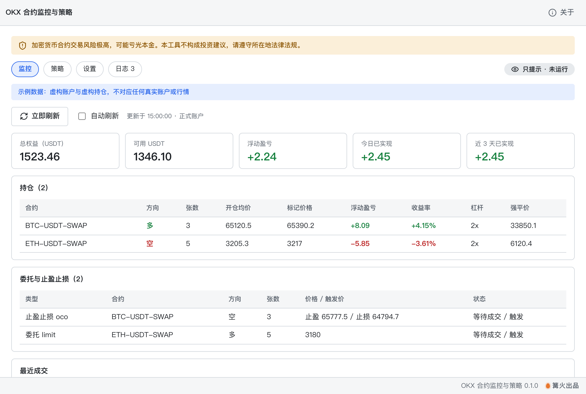

# OKX 合约监控与策略

> 篝火出品 · 收录于篝火 App 应用区

## 风险与免责

- **加密货币合约交易风险极高，可能亏光本金**（含杠杆放大的亏损）。
- **本工具不构成投资建议**。信号只是对历史价格的机械计算，不预测未来，也不保证盈利。
- 请遵守你所在地的法律法规；部分地区禁止或限制加密货币衍生品交易，是否可用由你自行判断。
- 默认只给信号、不下单。模拟盘与实盘自动下单都需要你主动选择；实盘必须在设置里二次确认并输入确认文字，且每次启动应用后重新解锁。
- 软件按「现状」提供，作者不对任何交易损失负责。

监控 OKX 合约账户的余额、持仓、盈亏、委托和成交；内置两套策略，默认只给信号、不下单，可切到 OKX 模拟盘，实盘自动下单需手动解锁。



## 下载

到 [Releases](https://github.com/campfire-code/okx-contract-monitor/releases/latest) 下载对应安装包：

| 电脑 | 文件 |
|---|---|
| Windows 10 / 11 | `okx-contract-monitor_版本号_windows-x64-setup.exe` |
| Mac（Apple 芯片） | `okx-contract-monitor_版本号_mac-arm64.dmg` |
| Mac（Intel 芯片） | `okx-contract-monitor_版本号_mac-x64.dmg` |

第一次打开：
- **Windows**：如果弹出「Windows 已保护你的电脑」，点「更多信息」→「仍要运行」。
- **Mac**：如果提示「无法验证开发者」，打开「系统设置 → 隐私与安全性」，在下方点「仍要打开」。

## 怎么用

**一、先只看信号（不需要 API Key）**
1. 打开后切到「策略」页，点「启动策略」。默认模式是「只提示」：每 60 秒用 OKX 公开行情算一次信号，显示方向、评分、建议张数、止盈止损价和预计止损亏损，**不会下任何单**。
2. 不想联网，也可以点「选择 K 线文件」，用本地 JSON 离线试算（文件格式见 `samples/`）。

**二、监控账户**
1. 去「设置」填 OKX 的 API Key、Secret Key、Passphrase，点「保存」「测试连接」。**建议在 OKX 创建 API Key 时只勾「读取」权限**，不要开提现。Key 只保存在本机设置文件（明文），日志里自动打码。
2. 回到「监控」页：总权益、可用 USDT、浮动盈亏、今日已实现、近 3 天已实现，持仓、委托与止盈止损单、最近成交。每 30 秒自动刷新，有新成交时在页面顶部提示并写入日志。

**三、模拟盘**
1. 在 OKX 的「模拟交易」里创建模拟盘 API Key，填到设置里；运行模式选「模拟盘」。所有请求会带请求头 `x-simulated-trading: 1`。
2. 点「启动策略」：有信号并通过风控时，会在模拟盘设置杠杆、预检、市价开仓，并随单附带止盈止损。

**四、实盘自动下单（不推荐新手）**
1. 运行模式选「实盘自动下单」，勾选风险确认并原样输入确认文字，点「解锁」。解锁只在本次运行有效，关闭应用即失效、策略停止；没有后台常驻。
2. 实盘下单前还会再校验：杠杆不得超过「最大杠杆」、名义金额不得超过「单笔最大名义金额」、所需保证金不得超过「最多动用保证金」、必须带止盈止损；并受单日亏损上限、连续亏损暂停、冷静期限制。

**两套策略**
- 多周期评分：5 分钟 RSI、MACD、EMA9/21、动量、量比综合评分，达到阈值才算信号；15 分钟趋势（四项里至少三项同向）反向时不开仓；1 分钟最近三次变化至少两次同向才确认；MACD 一票否决、RSI 极端值和明显反向动量时拦截；价格突破前 19 根 5 分钟高低点 0.2% 时进入冷静期，只禁止追反方向。持仓中评分反转且有浮盈，会提示「可考虑手动平仓」，**不会自动平仓**（已挂的止盈止损在交易所服务器上执行）。
- 快速趋势：1 分钟与 5 分钟均线、短期动量、24 小时走势、波动率打分，并过滤过热、回撤、当前 K 线偏弱、5 分钟动量不支持、临近资金费结算。

**默认参数（保守档，均可在设置里改）**：只提示；杠杆 2 倍，最大杠杆 3 倍；最多动用保证金 500 USDT；单笔最大亏损 5 USDT；单笔最大名义金额 1000 USDT；止损 0.5%，止盈 1%；单日亏损上限 20 USDT；连亏 3 次暂停；平仓后冷静 600 秒。BTC 永续每张约 0.01 BTC，名义金额设得太小会算不出整数张，界面会提示。

**说明**
- 只支持 USDT 本位永续合约（如 `BTC-USDT-SWAP`），全仓模式。
- 单日亏损、连亏、冷静期根据 OKX 返回的最近成交计算（接口只返回最近 3 天、最多 100 条），按本机时区的当天统计。
- 策略只在应用打开时运行。
- 日志只保存在内存里，不写文件。
- 以下接口依据 OKX 官方文档（https://www.okx.com/docs-v5/en/）核对：签名与请求头、`x-simulated-trading`、账户余额、持仓、未完成委托、未完成策略委托（`ordType=conditional,oco`）、近 3 天成交、K 线（新的在前）、设置杠杆、下单及随单止盈止损 `attachAlgoOrds`、下单预检、账户配置 `posMode`。**未核实**：模拟盘是否支持下单预检接口（预检失败时本工具会停止下单，不会跳过预检）；不同地区应使用的接口域名（默认 `https://openapi.okx.com`，可在设置里改）；真实账户上的完整联调。

## 验收用例

示例 K 线均为虚构数据，由公式生成，不对应真实行情；文件格式为 `{"c1": [...], "c5": [...], "c15": [...]}`，每项与 OKX K 线接口返回的 data 格式相同（新的在前）。试算时「24 小时开盘价」用文件里第一根 5 分钟 K 线的开盘价代替，不连接账户，不下单。

| 操作 | 应得到 |
|---|---|
| 打开「设置」，确认运行模式 | 默认选中「只提示」；顶部右侧标签显示「只提示 · 未运行」 |
| 「策略」页 → 选择 K 线文件 → `samples/示例K线-上涨回踩.json`（策略为默认的多周期评分） | 做多，评分 +2.7，价格 66552.4，名义金额约 1000 USDT，止盈 65793.42，止损 64816.29 |
| 同上，选 `samples/示例K线-下跌反弹.json` | 做空，评分 -2.7，价格 64277.7，止盈 64219.62，止损 65192.64 |
| 「设置」把「开仓评分阈值」改成 3，再选上涨回踩文件 | 观望（评分 2.7 达不到 3） |
| 「设置」把策略改成「快速趋势」，选 `samples/示例K线-快速趋势上行.json` | 做多，评分 +5，价格 66685.3 |
| 策略为「多周期评分」时选 `示例K线-快速趋势上行.json` | 提示「多周期评分策略还需要 c15（15 分钟 K 线）至少 30 根」 |
| 「监控」页，没填 Key | 显示「还没有填写 OKX API Key」，不发任何账户请求 |
| 「设置」运行模式选「实盘自动下单」，不勾选、不输入确认文字 | 「解锁」按钮灰色；标签显示「只提示（未解锁）」 |
| 勾选并原样输入确认文字后解锁；再切回「只提示」 | 标签变为「实盘」，切回后自动重新上锁 |
| 填保存 Key 后点「测试连接」 | 成功提示「连接成功，已能读取账户数据」；失败时显示 OKX 错误码，且密钥内容不出现在提示和日志里 |

## 自己编译

需要 Node.js 22、pnpm、Rust。

```bash
pnpm install
pnpm test          # 单元测试
pnpm tauri dev     # 开发运行
pnpm tauri build   # 打包
```

界面框架在 `src/kit`（所有 campfire-code 工具共用），本工具的逻辑在 `src/tool`。

## 归属

本工具由**篝火**出品，是篝火 App 应用区收录的开源工具之一，由篝火（GitHub 组织 [campfire-code](https://github.com/campfire-code)）维护与更新。全部工具的目录见 [toolkit-hub](https://github.com/campfire-code/toolkit-hub)。

## 许可证

MIT，版权方为篝火（campfire-code）。
